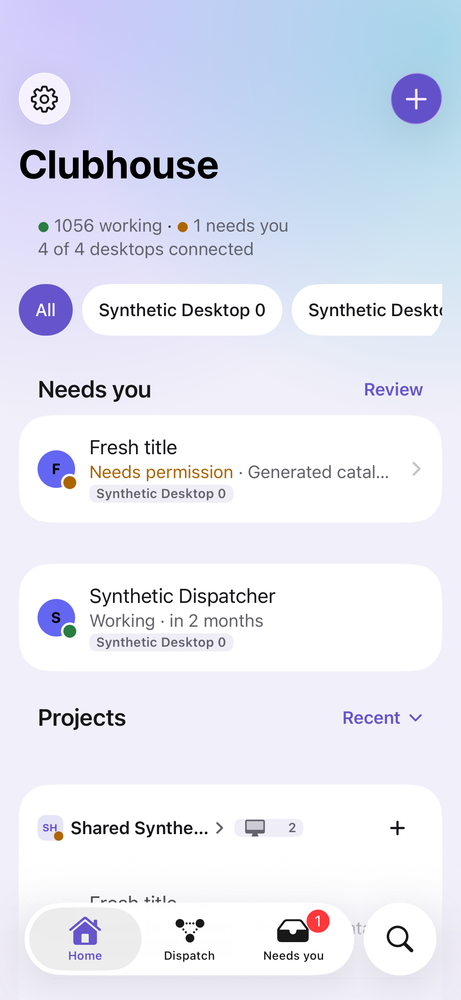
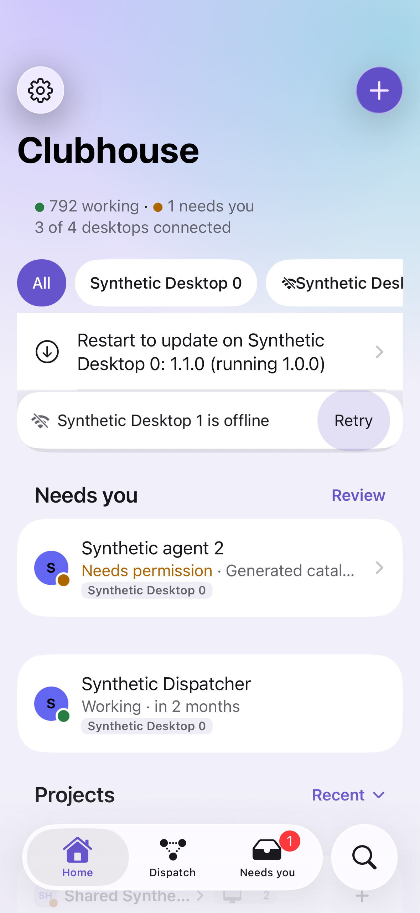
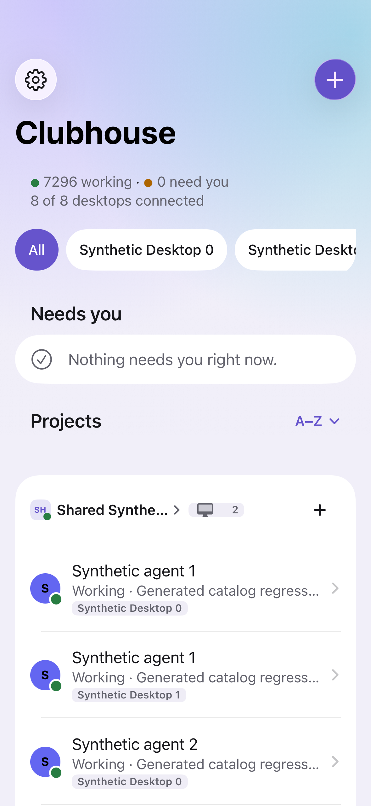
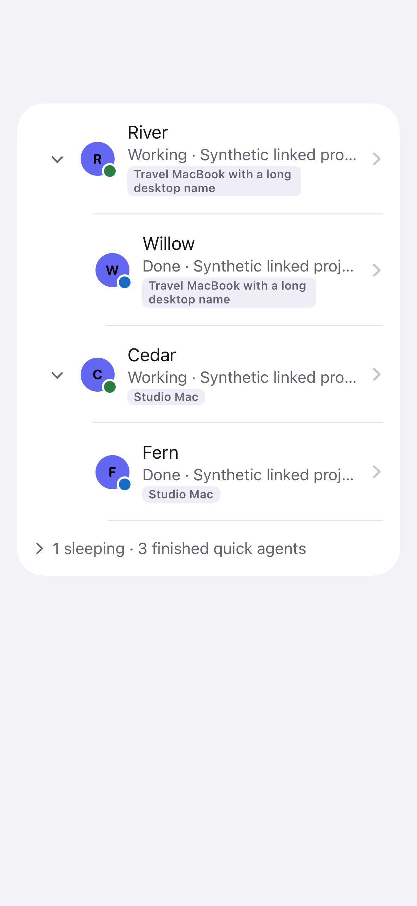
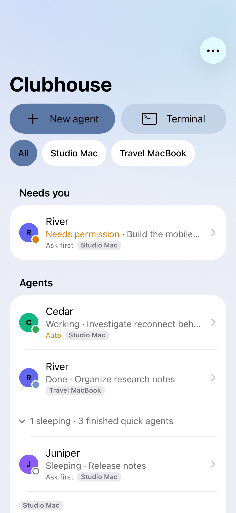
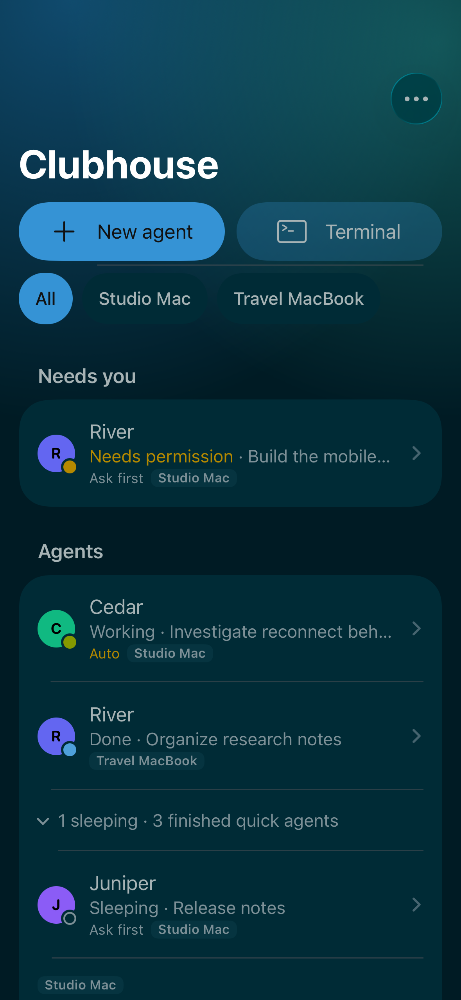
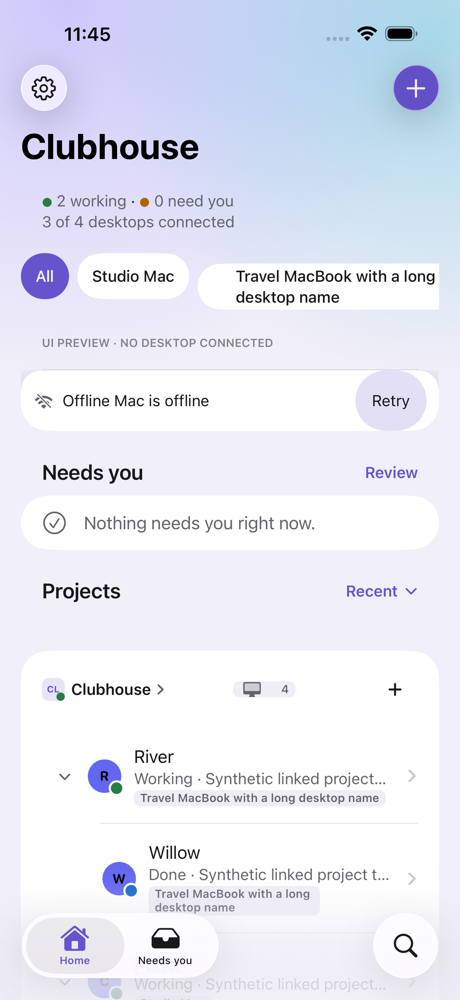
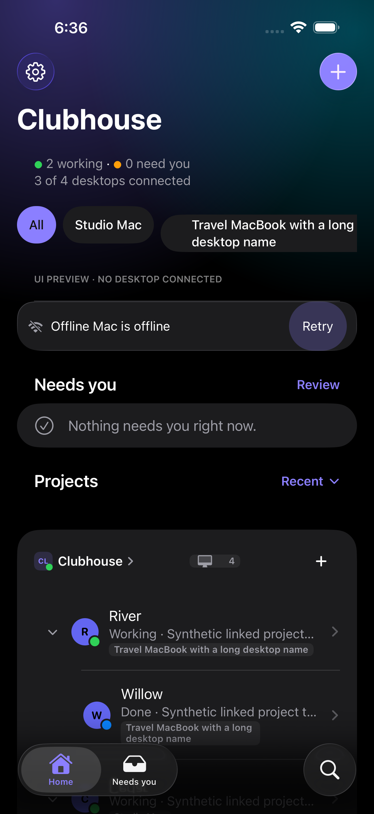
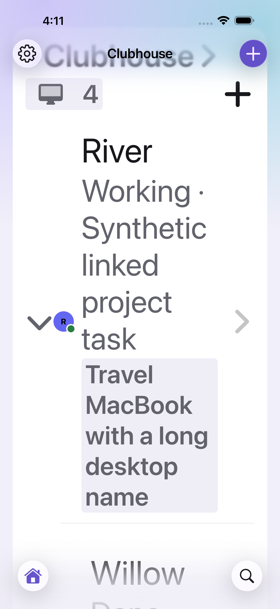
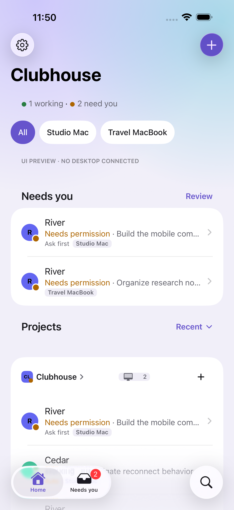

# Home pushed freeze evidence for #558

Code head: `48a6f022135c4df68a8b867e330ae16c1fdb5a4b`. Baseline: `67b8e5b88b84de190e0234290978615f33362d96`.

All fixtures are generated synthetic catalogs and memory services. Images are original XCTest PNG attachments, with their origins and SHA256 in [manifest.json](manifest.json). No phone data or phone install is involved.

| Gate | Result |
|---|---|
| Fresh Debug build / compiled deinit / policy | PASS / PASS / 20 PASS |
| Full strict pushed method | 1/0 PASS; byte-identical method fingerprint retained |
| Clean live streaming measurement | 2 main + 2 head invocations PASS; every head batch meets baseline and fixed count ceiling |
| Hosted regression | 27/27 PASS, no skips, retries or crashes |
| UI C1 | 14/14 PASS, strict PASS, no skips, retries or crashes |
| UI C2 | 26/26 PASS, strict PASS, no skips, retries or crashes |
| Package D | 73 tests / 11 suites PASS |
| Combined coverage | 1,691 tests / 204 suites PASS; Transport 96.84%, Domain 93.01%; ratchet OK |

See [the count table](kept-live-report.md) and [raw comparison](kept-live-comparison.json). Counts are the primary performance gate. Supporting app process CPU is not a phone battery or CPU-percentage claim. The cheap Home owner still reevaluates; all expensive pushed child counters remain unchanged.

## Current-head screenshots

Fresh Home after 100 hidden Dispatch updates:

Current connection state on first pop:

Large catalog: 8 desktops, 384 projects, 7,680 agents:

Linked rows hosted fixture:

Project page light and dark regression captures:

## Deliberate limits

Returning Home from another tab still scrolls to the top. Anchor restore is excluded, preserved unproven in #567 / Draft #568. The LargeCatalog hosted test constructs the production menu VALUE factory. C1 separately opens the live native project-header menu and checks Pin, Mark inactive and Project info. Frozen Home and agent-row native-menu coverage gap #564 remains open. Main already rebuilds visible Home on streamed updates from any loaded conversation; reducing that existing cost is the next #528 follow-up, not a claim made here.

## Native UI light, dark and AX5

The AX5 test retained strict row/viewport bounds, full-name and multiline OCR checks. [All OCR boxes and attribution](origin-every-ocr-box.json) and [geometry step 0](origin-geometry-step-0.json) / [step 1](origin-geometry-step-1.json) are retained.

The visible idle window had the same five late row/menu realisations on both sides; its high-level owner/content/layout/header/scope counts remained zero.

Combined current-main tree: clean merge `5988f83347d01716a706f5a565b84078eeea33cc` = main `e45aef3b453087976cf99420904cacfa541d76d2` + code head above, no file overlaps or manual resolutions. [Coverage report](combined-coverage-report.txt), [passing receipt](combined-coverage-r2-receipt.json), and [earlier zero-execution guard refusal](combined-coverage-r1-refused-receipt.json). The PR code head remains unchanged.
